<!-- COVER: everything above the END-COVER line is the title block at the top of page 1 -->

<h1 class="title">A Vision Inspection Assistant for an Organic Flower Farm</h1>

Camera calibration, classical image analysis, deep-learning flower recognition and their integration in an interactive assistant

<mark>[Your full name]</mark> Student ID: <mark>[Student ID]</mark> FCVG101 Introduction to Computer Vision, Coursework (60 % of the module) Submitted <mark>[dd/mm/yyyy]</mark>

Code and data repository: <a href="https://github.com/NhatNam041206/UOG_FCVG101_ComputerVision">https://github.com/NhatNam041206/UOG_FCVG101_ComputerVision</a> Trained model (MobileNetV3, 16.2 MB): <mark>[Shared link to the model weights and class list]</mark> Demonstration video (optional): <mark>[Link, if recorded]</mark>

Highlighted text marks a placeholder to complete before submission.

<!-- END-COVER -->

# 1. Introduction

## 1.1 Context and motivation

Visual inspection is a routine activity on a farm: a manager photographs a field, a bed of plants or an individual
flower and needs to judge what the image shows. The coursework asks for the first working version (minimum viable
product) of a system that supports this activity. The scenario adopted here is an organic flower farm, where the
assistant can clean a noisy photograph, highlight object outlines, compare two photographs of the same area, and
identify the flower species in an image.

Such a system needs a camera whose geometry is known, image-processing methods whose behaviour can be measured, and
a learned model for recognition. The brief formalises these needs as three minimum requirements plus an
integration task, summarised in Table 1.1.

| Requirement | Interpretation in this project | Chapter |
| --- | --- | --- |
| (a) Image acquisition and understanding through the camera model and calibration | Estimate the intrinsic parameters and lens distortion of the webcam and use them to undistort images | 3 (Task 1A) |
| (b) Classical image processing with measurable results | Implement and quantitatively evaluate denoising, frequency filtering, edge detection and feature matching | 4 (Task 1B) |
| (c) A task solved with a trained deep-learning model | Train, evaluate and select a flower-species classifier | 5 (Task 2) |
| Task 3: assistant feature | Identify the requested task, run the corresponding module and return a visual result | 6 (Task 3) |

: Table 1.1: Requirements of the coursework brief and where each is addressed.

## 1.2 Summary of results

Table 1.2 lists the principal quantitative outcomes. Each is derived and discussed in the chapter indicated in
Table 1.1.

| Component | Principal result |
| --- | --- |
| Camera calibration | 13 of 13 views accepted; RMS re-projection error 0.097 px |
| Denoising | Gaussian filter best for additive Gaussian noise (31.0 dB PSNR); median filter best for impulse noise (31.9 dB) |
| Feature matching | 501 ratio-test matches between two views of the same bridge, 97 % RANSAC inliers; at most 9 matches for an unrelated pair |
| Flower recognition | Test accuracy 94.5 %, macro F1 0.945, 18 ms per image on a laptop CPU |
| Assistant | Six tasks reachable from one interface; invalid requests return an explanatory message |

: Table 1.2: Summary of the principal results.

# 2. System design

## 2.1 Functional view

Figure 2.1 shows the use cases offered to the primary actor, the farm manager. Six use cases correspond to the
image-analysis tasks of the brief, and a seventh, camera calibration, also involves the webcam as a secondary actor.
Lens-distortion correction includes calibration, because undistortion requires the parameters that calibration
produces.

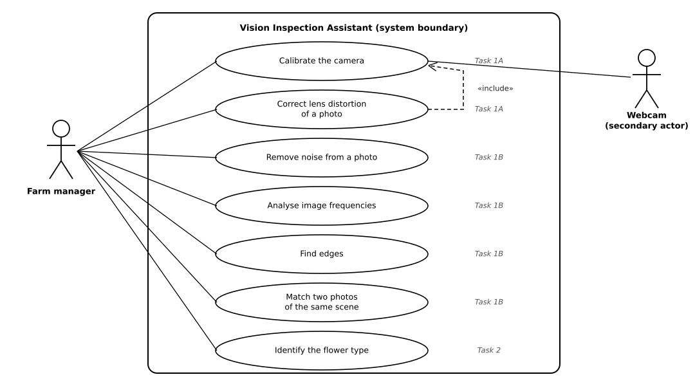{width=88%}

## 2.2 Architecture

The system is organised in three layers (Figure 2.2). The web application is the only layer visible to the user;
it collects the image and the selected task and displays the response, and it contains no image-processing logic.
The assistant validates requests and dispatches them. Three engines perform the computation: camera calibration
(Task 1A), classical image analysis (Task 1B) and flower recognition (Task 2).

The engines exchange information through persistent artifacts. Calibration creates a camera-parameter file, and
the training pipeline creates the model weights together with the ordered list of class names. The assistant
therefore answers requests without repeating calibration or training. A single configuration file holds every
adjustable parameter (board geometry, kernel sizes, thresholds, training hyperparameters), so that no value is
hidden in the source code.

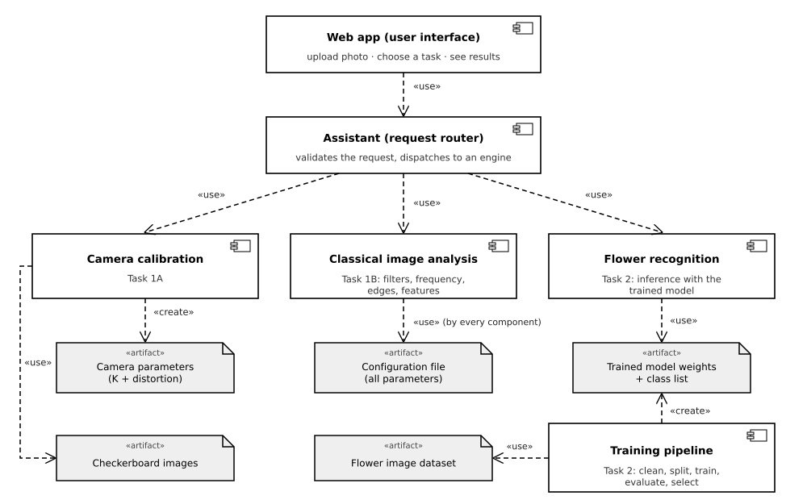{width=92%}

## 2.3 Request lifecycle

Figure 2.3 traces a classification request through the system. The assistant first validates the request. An
unknown task, or a missing second image for matching, leads to an explanatory message rather than a failure. A
valid request is forwarded to the recognition engine, which loads the model on first use, pre-processes the image
exactly as during training, and returns the predicted label, its confidence score and the three most likely
classes.

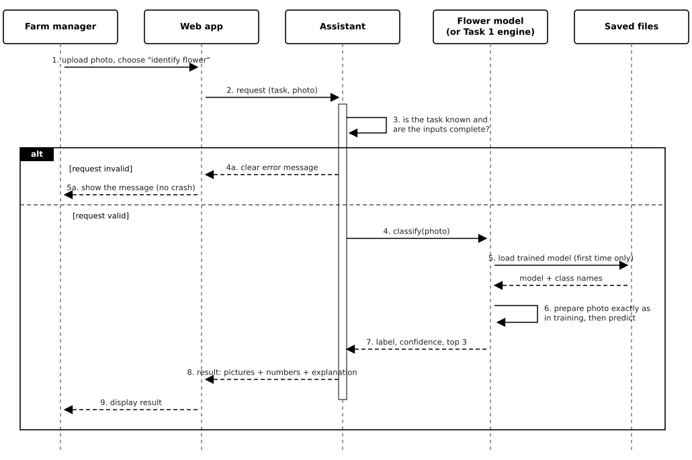{width=95%}

## 2.4 Principal design decisions

Table 2.1 summarises the design decisions that recur throughout the report. In each case a standard method was
implemented first and then compared with an alternative, so that the choice rests on measurements.

| Decision | Alternatives considered | Rationale | Section |
| --- | --- | --- | --- |
| Planar checkerboard calibration (Zhang) | 3-D calibration rig; self-calibration from natural images | Inexpensive target, sub-pixel corner localisation, standard implementation in OpenCV | 3.3 |
| Compare the full distortion model with $k_3 = 0$ | Always estimate five coefficients | With few views the highest-order term can over-fit | 3.6 |
| Evaluate filters on synthetically corrupted images | Visual judgement on naturally noisy images | A known clean reference makes PSNR an objective measure | 4.2 |
| Ratio test followed by RANSAC | Accept every nearest-neighbour match | Removes ambiguous and geometrically inconsistent matches | 4.5 |
| De-duplicate before splitting | Split the raw class folders | Prevents near-identical images in both training and test sets | 5.2 |
| Transfer learning with MobileNetV3 | Larger backbones (ResNet-50, VGG-16); training from scratch only | Highest accuracy per millisecond on a CPU; from-scratch training scored 17 points lower | 5.3 |
| Select on validation, report on test | Select the model with the best test score | Selecting on the test set biases the reported accuracy upwards | 5.5 |
| Table-driven assistant with a uniform response | Conditional chains; a language model that infers intent | Deterministic, testable, explains errors, and extensible by one table entry | 6.2 |

: Table 2.1: Principal design decisions.

# 3. Camera calibration (Task 1A)

## 3.1 Problem statement

Every geometric measurement taken from an image depends on the camera that produced it. A real lens bends straight
lines, most visibly near the image border (lens distortion), and each camera has its own focal length and principal
point. Calibration estimates these quantities once, after which images can be undistorted and pixel coordinates can
be related to viewing directions in the scene.

## 3.2 Camera model

The camera is described by the pinhole model extended with a polynomial lens-distortion model. Three successive
transformations take a point on the calibration board to a pixel.

**Rigid transformation.** For view $i$, a rotation $R_i$ and translation $t_i$ (the extrinsic parameters) map a board
point $X_w$ into camera coordinates:

$$X_c = R_i\,X_w + t_i = (X,\ Y,\ Z)^T$$ {#3.1}

where $Z$ is the depth along the optical axis.

**Normalisation and distortion.** The point is projected onto the plane $Z = 1$, giving normalised coordinates
$x = X/Z$ and $y = Y/Z$. With $r^2 = x^2 + y^2$, the lens displaces this point to

$$x_d = x\,(1 + k_1 r^2 + k_2 r^4 + k_3 r^6) + 2p_1 xy + p_2\,(r^2 + 2x^2)$$ {#3.2}

$$y_d = y\,(1 + k_1 r^2 + k_2 r^4 + k_3 r^6) + p_1\,(r^2 + 2y^2) + 2p_2 xy$$ {#3.3}

The bracketed factor is radial distortion. Because it grows with $r$, the displacement is largest at the image
border; a negative $k_1$ moves points towards the centre and produces barrel distortion. The terms in $p_1$ and $p_2$
model tangential distortion caused by a lens that is not exactly parallel to the sensor.

**Intrinsic projection.** The distorted point is finally mapped to pixel coordinates by the intrinsic parameters:

$$u = f_x\,x_d + c_x, \qquad v = f_y\,y_d + c_y$$ {#3.4}

Here $f_x$ and $f_y$ are the focal lengths in pixel units and $(c_x, c_y)$ is the principal point. These four values
form the intrinsic matrix $K = [\,f_x\ \ 0\ \ c_x;\ \ 0\ \ f_y\ \ c_y;\ \ 0\ \ 0\ \ 1\,]$ (skew is assumed zero). The
division by $Z$ in the normalisation step is the reason distant objects appear smaller.

## 3.3 Estimation by Zhang's method

**Homography of a planar target.** The board is planar, so its points can be written with $Z_w = 0$. The rotation
column $r_3$ then multiplies zero and disappears, and each view is related to the board by a $3 \times 3$
homography $H_i$:

$$s\,\tilde m = K\,[\,r_1\ \ r_2\ \ t\,]\,\tilde M = H_i\,\tilde M$$ {#3.5}

where $\tilde M = (X_w, Y_w, 1)^T$ and $\tilde m = (u, v, 1)^T$ are homogeneous coordinates and $s$ is an arbitrary
scale. Each $H_i$ can be estimated from the detected corners alone.

**Constraints on the intrinsics.** Writing $H_i = [\,h_1\ \ h_2\ \ h_3\,]$, the columns $r_1$ and $r_2$ of a rotation
are orthogonal and of equal length. Substituting $r_1 = K^{-1}h_1$ and $r_2 = K^{-1}h_2$ gives two equations per view:

$$h_1^T B\,h_2 = 0, \qquad h_1^T B\,h_1 = h_2^T B\,h_2, \qquad B = K^{-T}K^{-1}$$ {#3.6}

$B$ is symmetric and has five distinct unknowns when skew is included (four when it is fixed at zero), so at least
three views are required for a unique solution. The implementation rejects calibration with fewer than three valid
views. Solving the stacked linear system gives $B$, from which $K$ follows in closed form, and then $R_i$ and
$t_i$ follow from Equation 3.5.

**Non-linear refinement.** The closed-form solution ignores distortion and is sensitive to noise. It is therefore
used as the starting point of a Levenberg–Marquardt minimisation of the total squared re-projection error over all
parameters:

$$\min_{K,\ k,\ p,\ \{R_i, t_i\}}\ \sum_{i=1}^{n}\sum_{j=1}^{m} \lVert\, p_{ij} - \hat p(K, k, p, R_i, t_i, X_j)\,\rVert^2$$ {#3.7}

where $p_{ij}$ is corner $j$ detected in view $i$ and $\hat p$ is its projection through Equations 3.1 to 3.4. The
quality of the fit is reported as the root-mean-square (RMS) re-projection error over all $N = n \cdot m$ corners:

$$\text{RMS} = \sqrt{\frac{1}{N}\sum_{i=1}^{n}\sum_{j=1}^{m}\lVert\, p_{ij} - \hat p_{ij}\,\rVert^2}$$ {#3.8}

With $n = 13$ views and $m = 54$ corners, $N = 702$. The complete procedure is given as Algorithm 3.1 and drawn as
an activity diagram in Figure 3.1.

::: {.algorithm}
**Algorithm 3.1** Planar camera calibration

*Input:* images of a checkerboard with $6 \times 9$ inner corners and known square size. *Output:* $K$, distortion
coefficients $(k_1, k_2, p_1, p_2, k_3)$, per-view poses, RMS error.

1. For each image, detect the inner corners; discard the image if the full grid is not found.
2. Refine each detected corner to sub-pixel accuracy from the local intensity gradients.
3. If fewer than three valid views remain, stop and report an error.
4. Estimate one homography $H_i$ per view from the board-to-image correspondences.
5. Stack the constraints of Equation 3.6, solve for $B$, and recover $K$, $R_i$ and $t_i$ in closed form.
6. Refine all parameters, including distortion, by minimising Equation 3.7 with Levenberg–Marquardt.
7. Compute the RMS error (Equation 3.8) overall and per view; save $K$ and the distortion coefficients.
:::

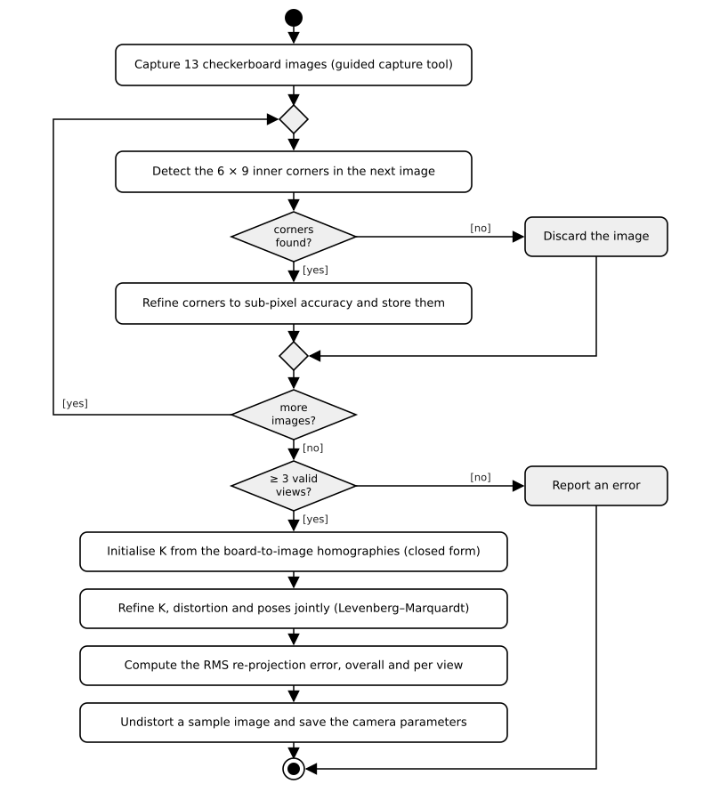{width=62%}

**Undistortion.** Once $K$ and the distortion coefficients are known, Equations 3.2 to 3.4 are inverted for every
pixel of a new image, so that straight lines in the scene appear straight in the corrected image.

## 3.4 Experimental set-up

The target was a board of $7 \times 10$ squares ($6 \times 9$ inner corners) displayed on a phone screen; one square
measured 9.1 mm with a ruler. The square size scales only the translations $t_i$ and does not affect $K$ or the
distortion coefficients. Thirteen images at $640 \times 480$ pixels were captured with a guided capture tool that
checks sharpness, coverage of the image area and variation of the board's tilt.
<mark>[Confirm how the 13 images were captured: if the capture tool's simulated lens-distortion option was enabled, state it here, because the curved black border in the distorted image of Figure 3.4 comes from it.]</mark>

The corners were detected with OpenCV's sector-based detector, which is more robust to blur and illumination
changes than the classic detector (retained only as a fallback). Several considerations guided the set-up:

- A checkerboard corner lies where black and white squares meet, a point that sub-pixel refinement locates to about
  one tenth of a pixel. A three-dimensional rig is in principle more accurate but must be manufactured precisely,
  and self-calibration from natural images is considerably less reliable.
- Three views are the theoretical minimum, but each additional view contributes 108 equations (54 corners × 2
  coordinates), which averages out detection noise. Tilting the board between views is necessary, because
  fronto-parallel views cannot separate the focal length from the distance to the board.
- The true camera parameters are unknown, so the RMS re-projection error is the appropriate measure of quality: it
  quantifies how well the fitted model reproduces the measurements, and it is the quantity reported by OpenCV and
  requested by the brief.

## 3.5 Results

All 13 views were accepted. Table 3.1 lists the estimated parameters.

| Parameter | Estimate | Interpretation |
| --- | --- | --- |
| Focal length $f_x$ / $f_y$ | 657.05 / 655.93 px | Nearly equal, consistent with square pixels |
| Principal point $(c_x, c_y)$ | (329.0, 227.0) px | Close to the geometric centre (320, 240) of the image |
| Horizontal field of view (derived) | approximately 52° | Typical of a laptop webcam |
| Radial distortion $k_1, k_2, k_3$ | −0.322, 0.239, −0.270 | Negative $k_1$: barrel distortion |
| Tangential distortion $p_1, p_2$ | 0.002, −0.008 | Negligible lens tilt |
| RMS re-projection error | 0.097 px (mean per view 0.081 px) | Sub-pixel fit |

: Table 3.1: Estimated camera parameters.

The full intrinsic matrix is $K = [\,657.05\ \ 0\ \ 329.03;\ \ 0\ \ 655.93\ \ 227.04;\ \ 0\ \ 0\ \ 1\,]$. Figure 3.2
shows that the error is below 0.1 px in every view with no outlier, and Figure 3.3 shows the detected corners on one
view.

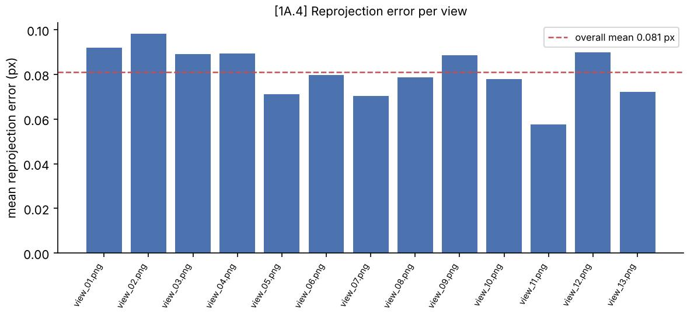{width=72%}

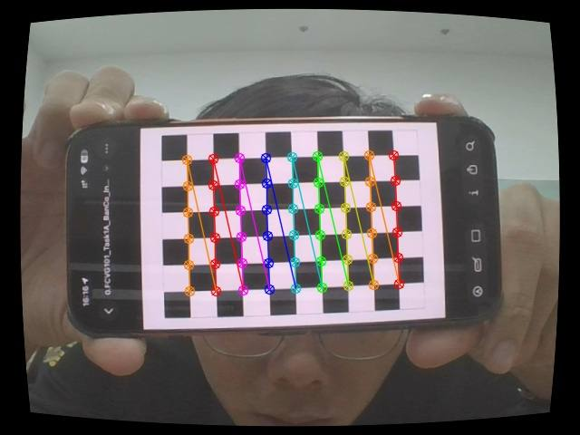{width=42%}

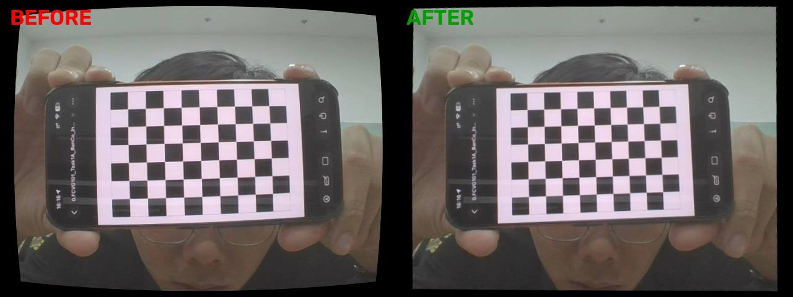{width=92%}

## 3.6 Model-order study

A model with more parameters always fits the data at least as well, so a lower RMS alone does not show that the
extra parameter is justified. With only 13 views, the highest-order coefficient $k_3$ is weakly constrained and can
trade off against $k_2$. A second calibration with $k_3$ fixed at zero produced an RMS of 0.0977 px against 0.0970 px,
the same focal lengths and principal point, and a more moderate $k_2$ (0.109 instead of 0.239). The two models explain
the data equally well. The reduced model is safer when extrapolating towards the image corners, while the full model
has the lowest error and is the one saved for the assistant.

# 4. Classical image analysis (Task 1B)

## 4.1 Scope and test data

Classical methods are fast, require no training data, and behave in ways that can be explained from first
principles. Task 1B covers four families of methods, each answering a practical inspection question (Table 4.1).

| Family | Inspection question |
| --- | --- |
| Spatial filtering | Can a noisy image be cleaned without losing detail? |
| Frequency-domain analysis | Which parts of the image are smooth regions and which are fine detail? |
| Edge detection | Where are the object boundaries? |
| Interest points and matching | Do two images show the same scene, and how are they related geometrically? |

: Table 4.1: Families of classical methods and the questions they address.

The four families run independently on the same test images (Figure 4.1), and every result is stored both as an
image and as a metric. The test images are real photographs from OpenCV's public test-data collection: a harbour
scene for filtering, frequency analysis and edges; two overlapping photographs of the Pont du Gard taken from the
same position while rotating the camera; and an unrelated cathedral interior used as a negative control for matching.

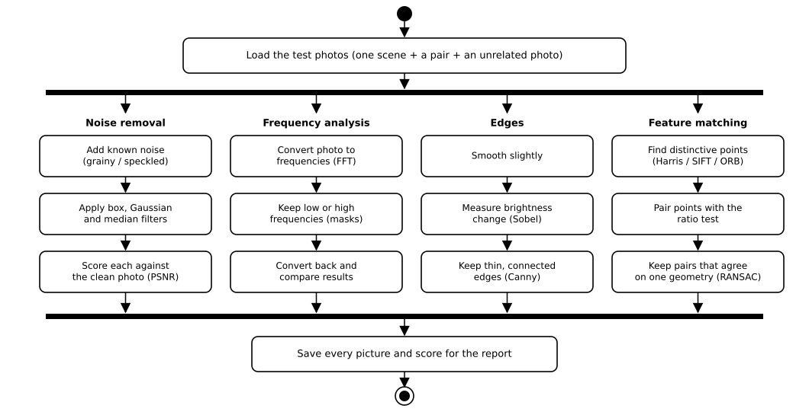{width=95%}

## 4.2 Spatial filtering and denoising

**Theory.** A linear spatial filter replaces each pixel by a weighted sum of its neighbours. For a $5 \times 5$
kernel $h$ applied to image $f$, this is the discrete convolution

$$g(x, y) = \sum_{i=-2}^{2}\sum_{j=-2}^{2} h(i, j)\,f(x - i,\ y - j)$$ {#4.1}

The box filter uses $h(i, j) = 1/25$, a uniform average. The Gaussian filter uses weights that decay with distance
from the centre,

$$h(i, j) = \frac{1}{W}\exp\left(-\frac{i^2 + j^2}{2\sigma^2}\right), \qquad \sigma = 1.2$$ {#4.2}

where $W$ normalises the weights to sum to one. The median filter is non-linear: it sorts the 25 values in the window
and returns the 13th. A few extreme values cannot move the median of a sorted list, which makes the filter robust to
outliers. Averaging $n$ pixels whose noise is independent with standard deviation $\sigma_n$ reduces it to
$\sigma_n / \sqrt{n}$; the cost is that genuine edges are also smoothed.

**Evaluation metric.** For a clean image $I$ and a filtered image $\hat I$, each with $N$ pixels,

$$\text{MSE} = \frac{1}{N}\sum_{x, y}\left(I(x, y) - \hat I(x, y)\right)^2, \qquad \text{PSNR} = 10\log_{10}\frac{255^2}{\text{MSE}}\ \text{dB}$$ {#4.3}

where 255 is the maximum grey level. PSNR is logarithmic: an increase of 3 dB corresponds to halving the MSE.

**Experimental design.** An objective score needs a clean reference, so known noise was added to a clean image. Two
noise models represent the two common practical cases: additive Gaussian noise with a standard deviation of 20 grey
levels (sensor noise in low light) and impulse (salt-and-pepper) noise affecting 5 % of pixels (defective pixels or
transmission errors). A $5 \times 5$ window was used: at these noise levels a $3 \times 3$ window removes too little
noise, while $7 \times 7$ blurs fine structures such as the ship's rigging. For the Gaussian kernel, the window
should contain approximately $\pm 2\sigma$ of the bell curve, which gives $\sigma \approx 1$ to $1.25$. PSNR does not
model human perception, but it is simple and reproducible, which is sufficient for comparing filters on the same
image.

**Results.**

| Noise model | Noisy input | Box | Gaussian | Median |
| --- | --- | --- | --- | --- |
| Additive Gaussian | 22.2 dB | 30.1 dB | **31.0 dB** | 29.8 dB |
| Impulse (salt-and-pepper) | 18.6 dB | 28.7 dB | 28.7 dB | **31.9 dB** |

: Table 4.2: PSNR of each filter on each noise model (higher is better).

**Discussion.** No single filter is best; the appropriate choice depends on the noise model. Additive Gaussian noise
perturbs every pixel slightly, so averaging is effective, and the Gaussian weighting preserves edges slightly better
than the uniform box. Impulse noise affects few pixels by extreme amounts: averaging spreads each outlier into a grey
blotch, whereas the median discards it, and the median filter's gain of more than 3 dB means less than half the error
of the linear filters. As a check of understanding, all three filters were also implemented from first principles;
the box filter matches OpenCV exactly and the Gaussian filter matches to within one grey level.

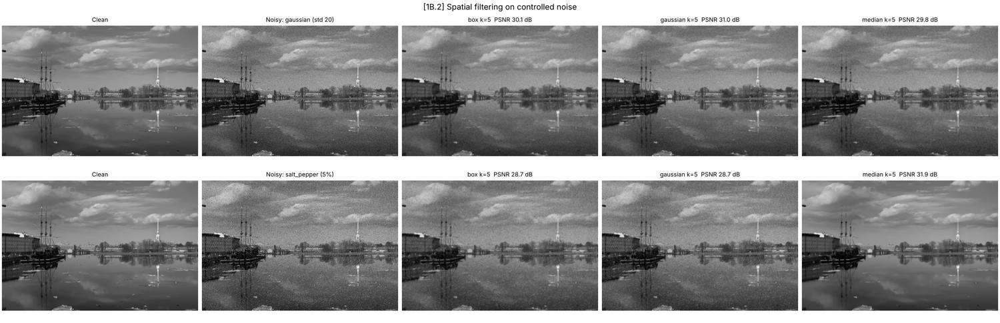{width=100%}

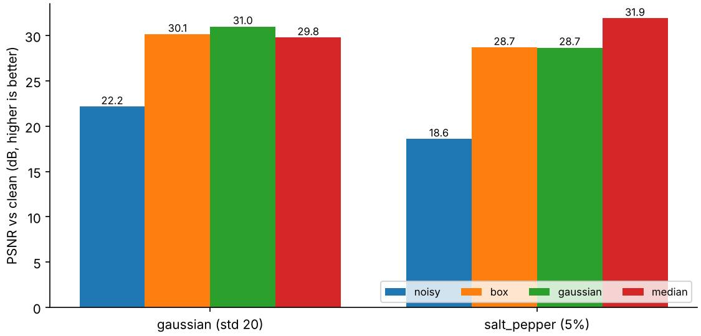{width=55%}

## 4.3 Frequency-domain filtering

**Theory.** The two-dimensional discrete Fourier transform (DFT) expresses an $M \times N$ image as a weighted sum of
complex sinusoids:

$$F(u, v) = \sum_{x=0}^{M-1}\sum_{y=0}^{N-1} f(x, y)\,e^{-j2\pi\left(\frac{ux}{M} + \frac{vy}{N}\right)}$$ {#4.4}

The magnitude $|F(u, v)|$ measures how strongly the sinusoid of frequency $(u, v)$ is present. After the zero
frequency is shifted to the centre, coefficients near the centre describe slow intensity variations (smooth regions)
and coefficients far from it describe rapid variations (fine detail and edges). Because the central value exceeds
the rest by several orders of magnitude, the spectrum is displayed as $\log(1 + |F|)$. The fast Fourier transform
(FFT) computes Equation 4.4 in $O(MN \log MN)$ operations.

The convolution theorem links the two domains:

$$f * h \ \longleftrightarrow\ F \cdot H$$ {#4.5}

Filtering therefore reduces to multiplying the spectrum by a mask $H$ and applying the inverse transform. With $D(u,v)$
the distance from the centre of the spectrum and $D_0$ the cut-off radius, three low-pass masks were compared:

$$H_{\text{ideal}}(u, v) = 1\ \ \text{if}\ D(u, v) \le D_0, \qquad H_{\text{ideal}}(u, v) = 0\ \ \text{otherwise}$$ {#4.6}

$$H_{\text{Gauss}} = \exp\left(-\frac{D^2}{2D_0^2}\right), \qquad H_{\text{Butterworth}} = \frac{1}{1 + (D/D_0)^{2n}},\ \ n = 2$$ {#4.7}

The corresponding high-pass mask is $1 - H$. A discontinuity in one domain produces oscillations in the other: the
inverse transform of a sharp disc is a ripple pattern. This explains the ringing observed near strong edges with the
ideal mask and its absence with the smooth Gaussian and Butterworth masks.

**Results and discussion.** With $D_0 = 26$ (about 3 % of the image width) the low-pass result preserves the layout of
the harbour scene while removing fine texture, and the high-pass result retains the rigging and the skyline (Figure
4.4). A sweep over $D_0 \in \{15, 26, 40\}$ shows the trade-off: the smaller the radius, the more detail moves from
the low-pass to the high-pass image. The ideal mask is kept as a baseline precisely because its ringing illustrates
Equation 4.5. Frequency analysis also explains the spatial methods: a blur is a low-pass filter and an edge detector
is a high-pass filter.

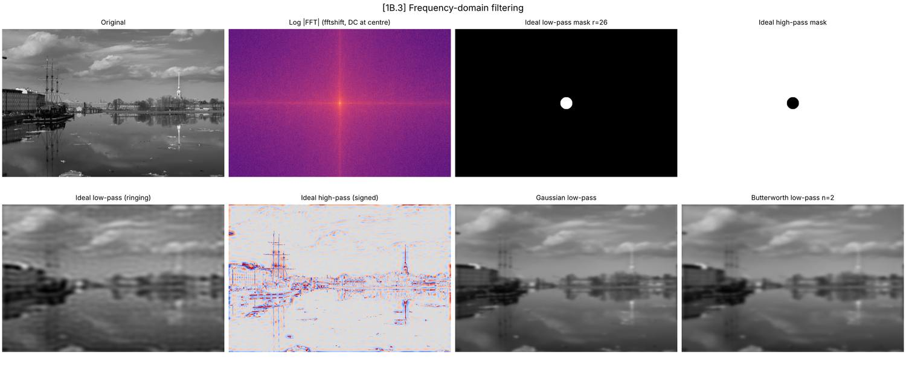{width=100%}

## 4.4 Edge detection

**Theory.** An edge is a location of rapid intensity change, characterised by the image gradient. The Sobel operator
estimates its components by convolving the image with two $3 \times 3$ kernels: $G_x$ uses the rows
$[-1\ 0\ 1]$, $[-2\ 0\ 2]$, $[-1\ 0\ 1]$, and $G_y$ is its transpose. The central weight of 2 provides built-in
smoothing perpendicular to the derivative. Gradient magnitude and orientation follow as

$$|G| = \sqrt{G_x^2 + G_y^2}, \qquad \theta = \arctan\frac{G_y}{G_x}$$ {#4.8}

Thresholding $|G|$ directly gives thick and fragmented edges. Canny's detector was designed to satisfy three
criteria (good detection, good localisation, and a single response per edge) and proceeds as in Algorithm 4.1.

::: {.algorithm}
**Algorithm 4.1** Canny edge detection

*Input:* grey-level image, thresholds $T_{\text{low}} < T_{\text{high}}$. *Output:* binary edge map.

1. Smooth the image with a $5 \times 5$ Gaussian kernel ($\sigma = 1.2$); differentiation amplifies noise, so it must be
   suppressed first.
2. Compute $|G|$ and $\theta$ with the Sobel kernels (Equation 4.8).
3. Non-maximum suppression: keep a pixel only if $|G|$ exceeds both neighbours along the direction $\theta$, which
   thins edges to one pixel.
4. Hysteresis: mark pixels with $|G| \ge T_{\text{high}}$ as strong edges, discard pixels with $|G| < T_{\text{low}}$,
   and keep intermediate pixels only if they are connected to a strong edge.
:::

The two thresholds allow a faint but continuous boundary to be kept while isolated noise responses are rejected. A
ratio $T_{\text{high}} : T_{\text{low}}$ between 2:1 and 3:1 is recommended by Canny; the setting (80, 160) uses 2:1.
An automatic variant derives both thresholds from the median intensity $m$ of the image:

$$T_{\text{low}} = 0.67\,m, \qquad T_{\text{high}} = 1.33\,m$$ {#4.9}

**Results.** The fraction of pixels labelled as edges decreases as the thresholds rise (Table 4.3).

| Thresholds $(T_{\text{low}}, T_{\text{high}})$ | (40, 100) | (80, 160) | (120, 240) | automatic (75, 148) |
| --- | --- | --- | --- | --- |
| Edge pixels | 3.6 % | **1.7 %** | 0.7 % | 2.0 % |

: Table 4.3: Fraction of edge pixels for different Canny thresholds.

**Discussion.** Low thresholds also respond to water ripples and cloud texture, and high thresholds lose faint
building outlines. The setting (80, 160) retains the meaningful boundaries with little clutter. The automatic
setting of Equation 4.9 lands close to it, which suits a user who does not wish to tune parameters.

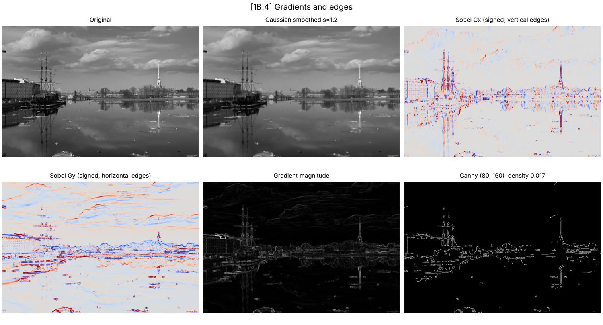{width=88%}

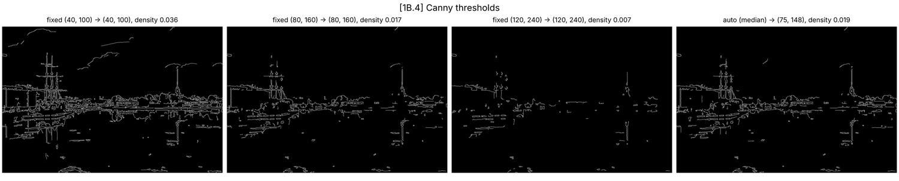{width=100%}

## 4.5 Interest points and image matching

To decide whether two images show the same scene, the system detects interest points (small, distinctive
structures such as corners that can be re-detected from another viewpoint), describes each with a descriptor
vector, and matches descriptors between the images. Three detectors with different trade-offs were compared.

**Harris corners.** Consider shifting a small window by $(\Delta x, \Delta y)$. To second order, the change in
intensity is the quadratic form $[\Delta x\ \Delta y]\,M\,[\Delta x\ \Delta y]^T$, where $M = [\,A\ \ C;\ \ C\ \ B\,]$ is
the structure tensor with entries

$$A = \sum_{x, y} w\,I_x^2, \qquad B = \sum_{x, y} w\,I_y^2, \qquad C = \sum_{x, y} w\,I_x I_y$$ {#4.10}

Here $I_x$ and $I_y$ are image derivatives and $w$ is a Gaussian window. The eigenvalues $\lambda_1, \lambda_2$ of
$M$ measure the intensity change along its two principal directions: both small indicates a flat region, one large
an edge, and both large a corner. Harris and Stephens avoid computing eigenvalues explicitly by using

$$R = \det M - k\,(\operatorname{trace} M)^2 = \lambda_1\lambda_2 - k(\lambda_1 + \lambda_2)^2 = (AB - C^2) - k(A + B)^2$$ {#4.11}

with $k = 0.04$. $R$ is large and positive only at corners. Points whose response exceeds 3.5 % of the maximum and is
a local maximum are retained.

**SIFT and ORB.** SIFT detects blob-like structures as extrema of the difference of Gaussians across scales, so that
the same point is found regardless of its apparent size. Its descriptor consists of 128 values: gradient-orientation
histograms over a $4 \times 4$ grid, rotated to the dominant orientation for rotation invariance. ORB detects
corners with the FAST test and describes them with 256 binary intensity comparisons (rotated BRIEF), so descriptors
are compared with the Hamming distance instead of the Euclidean distance used for SIFT.

**Ratio test.** For each descriptor, let $d_1$ and $d_2$ be the distances to its nearest and second-nearest
neighbours in the other image. The match is accepted only if

$$d_1 < 0.75\,d_2$$ {#4.12}

A correct match is usually much closer than any alternative, whereas an incorrect one, typical of repeated
patterns, has several candidates at similar distances. Lowe reported that a threshold of about 0.8 removes roughly
90 % of false matches while losing fewer than 5 % of correct ones; 0.75 is slightly stricter and is the value used in
the course workshop.

**Geometric verification with RANSAC.** The two bridge photographs were taken from one position while rotating the
camera, so all correct matches must agree on a single homography $H$ (eight degrees of freedom, determined by four
correspondences). A homography is the correct model for a rotating camera or a planar scene; for general viewpoints
the fundamental matrix would be required. RANSAC estimates $H$ robustly as in Algorithm 4.2.

::: {.algorithm}
**Algorithm 4.2** RANSAC homography estimation

*Input:* putative matches $\{(x_k, x'_k)\}$, inlier threshold $\tau = 5$ px. *Output:* homography $H$ and its inlier set.

1. Randomly select four matches and compute the homography $H$ that maps them exactly.
2. Count the inliers: matches with $\lVert x'_k - H x_k \rVert < \tau$ after dehomogenisation.
3. Repeat steps 1 and 2, keeping the $H$ with the largest inlier set.
4. Re-estimate $H$ by least squares on all inliers of the best model.
:::

Incorrect matches point in unrelated directions and rarely agree with one another, so they fall outside the
consensus set. If a fraction $w$ of the matches is correct, the number of iterations needed to draw at least one
all-inlier sample with probability $P$ is

$$T = \frac{\log(1 - P)}{\log(1 - w^4)}$$ {#4.13}

which remains small when the ratio test has already removed most outliers.

**Experimental design.** The three detectors were applied to the same bridge pair to measure their trade-offs, and
to the bridge–cathedral pair as a negative control: a matcher that always finds matches is of no use, and the
unrelated pair exposes the false-match rate. As a check of understanding, the Harris detector was also implemented
from first principles; it finds the same 80 corners as OpenCV, located on the building, the spire, the rigging and
ice on the water, and never on the flat sky.

**Results.**

| Image pair | Detector | Ratio-test matches | RANSAC inliers | Inlier ratio | Time |
| --- | --- | --- | --- | --- | --- |
| Same bridge | ORB | 353 | 335 | 94.9 % | 64 ms |
| Same bridge | SIFT | **501** | **487** | 97.2 % | 221 ms |
| Same bridge | Harris | 483 | 473 | **97.9 %** | **32 ms** |
| Unrelated | ORB | 4 | 4 | n/a | 45 ms |
| Unrelated | SIFT | 9 | 4 | n/a | 232 ms |
| Unrelated | Harris | 3 | 0 | n/a | 30 ms |

: Table 4.4: Matching results for the related and the unrelated image pairs.

**Discussion.** For the same scene, every detector yields hundreds of geometrically consistent matches; SIFT finds
the most at roughly three times the cost of ORB. For the unrelated pair, the ratio test alone removes more than 99 %
of the candidate matches. The four inliers out of four for ORB do not indicate a real match: a homography always fits
any four correspondences exactly. A decision rule of "same scene if at least about 15 matches are inliers" accepts
every related pair and rejects every unrelated pair in these experiments.

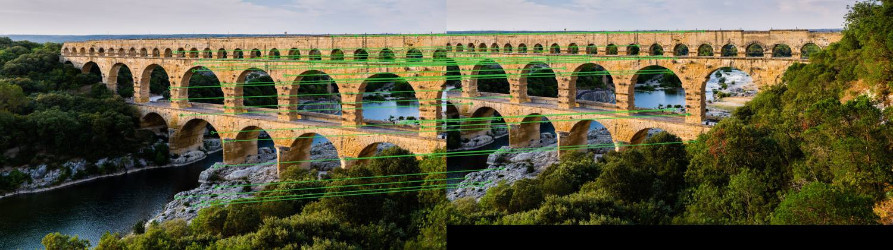{width=100%}

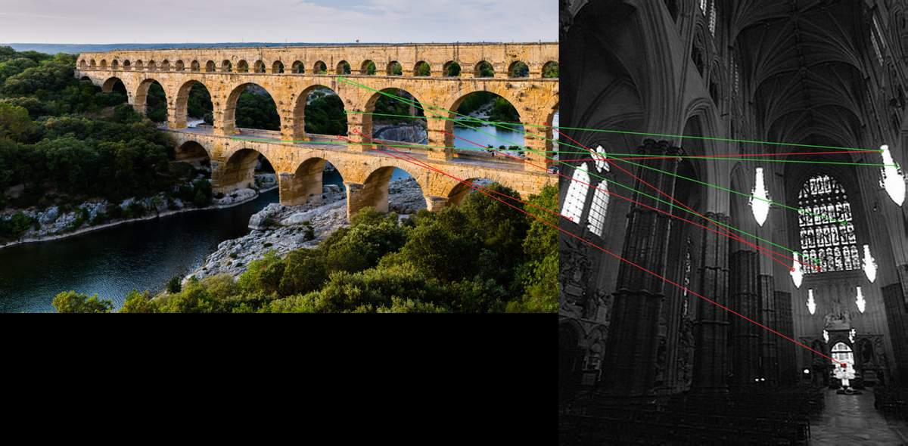{width=75%}

# 5. Flower recognition (Task 2)

## 5.1 Task and dataset

The deep-learning task is five-class image classification: given a photograph, predict whether it shows a daisy,
dandelion, rose, sunflower or tulip. Recognising the crop is the first step of most inspection tasks on a flower
farm.

The dataset is TensorFlow Flowers: 3,670 colour photographs in one folder per class, released under the CC-BY 2.0
licence. It was chosen for the following reasons:

- The images are amateur photographs with varied lighting, backgrounds, scales and occasionally several flowers or
  people, so cleaning and augmentation have a real effect.
- Roses and tulips are visually similar, which makes the evaluation informative.
- The dataset is large enough to train a network and small enough to train and compare several models on a laptop in
  about an hour.
- The classes are mildly imbalanced (633 daisies against 898 dandelions), so a class-balanced metric is reported
  alongside accuracy.
- It is freely downloadable, which makes the experiments reproducible.

## 5.2 Data pipeline

The pipeline converts the raw download into training data (Figure 5.1, steps 1 to 5; Table 5.1). Two ordering
constraints matter. Cleaning precedes splitting, so that near-duplicates cannot appear in both the training and the
test sets and inflate the score. Augmentation is applied to training images only, so that validation and test
images remain an unbiased sample.

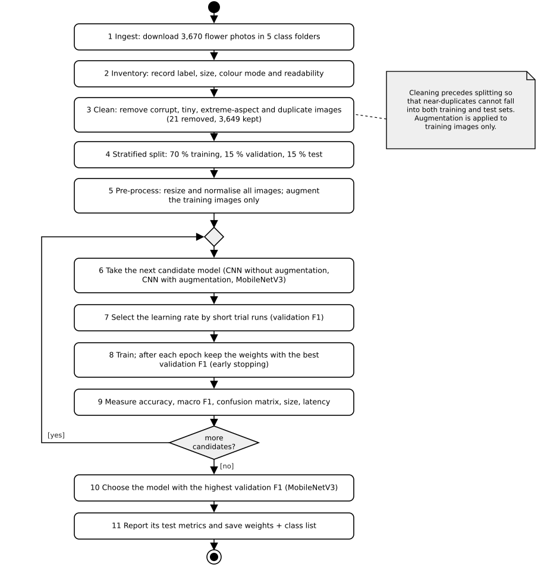{width=74%}

| Step | Operation | Outcome |
| --- | --- | --- |
| 1. Ingest | Download and extract the archive once | 3,670 images |
| 2. Inventory | Record class, size, colour mode and readability of every image | Inventory table |
| 3. Clean | Remove unreadable images, images smaller than 64 px, and images with an aspect ratio above 3:1; group near-duplicates by perceptual hash. Within a group of the same class keep the largest copy; drop groups whose members carry different labels | 21 removed (16 duplicates, 3 extreme aspect ratios, 2 label conflicts); 3,649 kept |
| 4. Split | Stratified random split into training (70 %), validation (15 %) and test (15 %) sets | 2,554 / 547 / 548 images |
| 5. Pre-process | Resize and normalise every image; augment training images with random crops, horizontal flips, small rotations, colour jitter and slight noise | Same pre-processing reused by the assistant |

: Table 5.1: Steps of the data pipeline.

**Near-duplicate detection.** Each image is reduced to $9 \times 8$ grey pixels, and each pixel is compared with its
right-hand neighbour, giving a 64-bit difference hash $b \in \{0, 1\}^{64}$. Resizing or re-compressing an image
barely changes these comparisons. Two images are treated as near-duplicates when the Hamming distance between their
hashes satisfies

$$d_H(b, b') = \sum_{k=1}^{64} [\,b_k \ne b'_k\,] \le 4$$ {#5.1}

A byte-level file comparison would miss copies saved at another resolution.

**Splitting and normalisation.** A stratified split keeps the class proportions identical in each subset, so a score
cannot change merely because one subset contains more examples of an easy class. Three subsets are used because every
choice (learning rate, best epoch, best model) is made on the validation set and the test set is used once, at the
end. Images are normalised with the ImageNet channel means and standard deviations, the scaling under which the
pre-trained network was trained.

**Augmentation.** Each transformation preserves the class: a flower remains the same species when mirrored, slightly
rotated, cropped or lit differently, and these variations teach the network which factors are irrelevant. Hue is
perturbed by only 3 %, since colour is a genuine cue, and vertical flips are excluded because photographs have a
natural orientation.

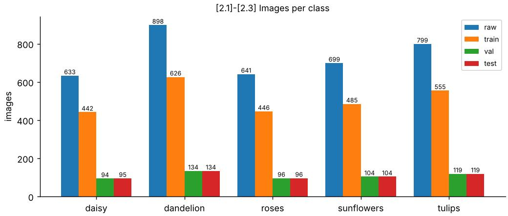{width=60%}

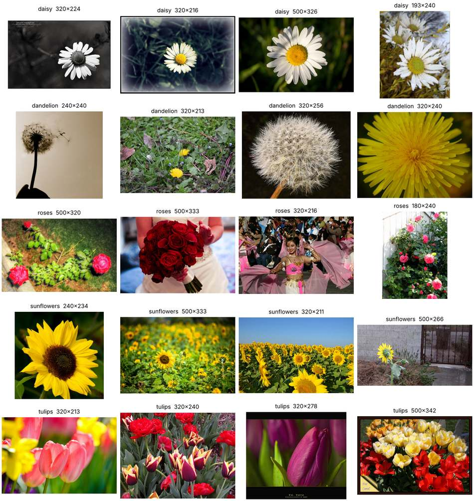{width=55%}

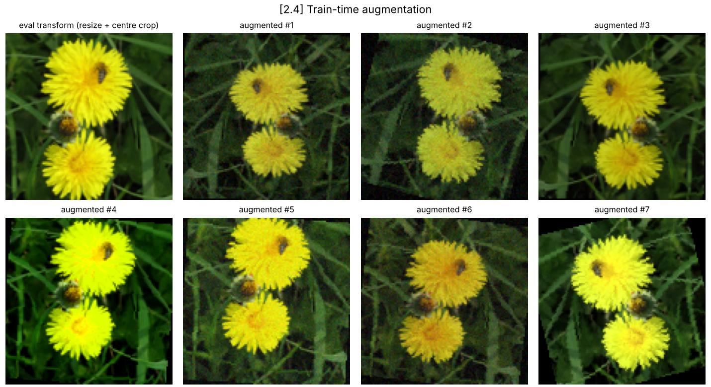{width=80%}

## 5.3 Models

**Convolutional networks.** A convolutional layer applies a bank of learned kernels using the operation of Equation
4.1, with weights learned from data instead of designed by hand. Each convolution is followed by batch
normalisation, which rescales activations to a stable range and accelerates training, and by the rectified linear
unit $\operatorname{ReLU}(x) = \max(0, x)$, which makes the network non-linear. Max-pooling keeps the largest response in
each $2 \times 2$ block and halves the spatial resolution. Because the same kernel is applied at every position, a
petal is recognised wherever it appears, with far fewer parameters than a fully connected network. The final layer
outputs one score $z_c$ per class, converted into probabilities by the softmax function:

$$p_c = \frac{e^{z_c}}{\sum_{c'=1}^{5} e^{z_{c'}}}$$ {#5.2}

**Baseline: a compact CNN trained from scratch.** Four blocks of convolution, normalisation, ReLU and pooling double
the number of channels from 32 to 256 while halving the resolution, followed by a linear classifier. The network has
0.39 million parameters (1.5 MB) and must learn all features from the 2,554 training images. It was trained with and
without augmentation to measure the effect of augmentation. One convolution per block keeps training practical on a
laptop CPU.

**Transfer learning with MobileNetV3.** MobileNetV3 is pre-trained on the 1.2 million images of ImageNet, so its early
layers already encode edges, textures and object parts. Its classifier was replaced by a new five-class layer.
MobileNetV3 replaces each standard convolution by a depthwise convolution followed by a $1 \times 1$ pointwise
convolution. For a $k \times k$ kernel with $C_{\text{in}}$ input and $C_{\text{out}}$ output channels, the ratio of
the cost of the separable form to the standard form is

$$\frac{k^2 C_{\text{in}} + C_{\text{in}} C_{\text{out}}}{k^2 C_{\text{in}} C_{\text{out}}} = \frac{1}{C_{\text{out}}} + \frac{1}{k^2}$$ {#5.3}

which for $k = 3$ and typical channel counts is about one eighth to one ninth. With 4.2 million parameters,
MobileNetV3 is about 6 times smaller than ResNet-50 and 30 times smaller than VGG-16, and its architecture was found
by automated search for mobile devices. These properties suit an assistant that runs on a laptop without a GPU.

## 5.4 Training procedure

**Loss function.** Training minimises the cross-entropy between a target distribution $q$ and the predicted
distribution $p$. With label smoothing $\varepsilon = 0.1$ over $C = 5$ classes, the target for an image of class $y$ is

$$q_c = (1 - \varepsilon)\,[\,c = y\,] + \frac{\varepsilon}{C}, \qquad L = -\sum_{c=1}^{C} q_c \log p_c$$ {#5.4}

that is, 0.92 for the correct class and 0.02 for each other class. The loss is smallest when the prediction matches
these targets and grows rapidly for confident errors; smoothing discourages over-confident predictions.

**Optimisation.** Gradients of $L$ with respect to all weights are obtained by back-propagation, and the weights are
updated with AdamW. AdamW maintains running estimates of the first and second moments of each gradient and adapts the
step size per weight; weight decay ($\lambda = 10^{-4}$) is applied directly to the weights,

$$\theta_{t+1} = \theta_t - \eta_t\left(\frac{\hat m_t}{\sqrt{\hat v_t} + \epsilon} + \lambda\,\theta_t\right)$$ {#5.5}

where $\hat m_t$ and $\hat v_t$ are the bias-corrected moment estimates. The learning rate follows a cosine schedule
over $T$ steps,

$$\eta_t = \frac{1}{2}\,\eta_0\left(1 + \cos\frac{\pi t}{T}\right)$$ {#5.6}

which takes large steps early and small steps at the end.

**Two-stage fine-tuning.** The new classifier starts from random weights. If the whole network were trained
immediately, the large errors of the random layer would push the pre-trained weights in arbitrary directions.
MobileNetV3 is therefore trained in two stages: the backbone is frozen while the new layer is trained for two epochs,
and the full network is then fine-tuned for six epochs.

**Early stopping and hyperparameter selection.** The compact CNN was trained for 15 epochs and MobileNetV3 for 8
(2 + 6). After each epoch the validation macro F1 was computed and the best weights were kept, which prevents
over-fitting without fixing the number of epochs in advance. The learning rate was selected by short trial runs on
the validation set (Table 5.2). Other settings were an input size of $112 \times 112$ for the compact CNN and
$160 \times 160$ for MobileNetV3, and a batch size of 32.

| Model | Learning rate → validation macro F1 | Selected |
| --- | --- | --- |
| Compact CNN | 0.003 → 0.681; **0.001 → 0.696**; 0.0003 → 0.690 | 0.001 |
| MobileNetV3 (fine-tuning) | **0.001 → 0.951**; 0.0003 → 0.944; 0.0001 → 0.928 | 0.001 |

: Table 5.2: Learning-rate search on the validation set.

## 5.5 Evaluation protocol

Accuracy is the fraction of test images classified correctly. For one class, with $TP$ the correctly recognised
images of that class, $FP$ the images of other classes assigned to it, and $FN$ the images of that class that were
missed,

$$\text{precision} = \frac{TP}{TP + FP}, \qquad \text{recall} = \frac{TP}{TP + FN}, \qquad F_1 = \frac{2\cdot\text{precision}\cdot\text{recall}}{\text{precision} + \text{recall}}$$ {#5.7}

The macro F1 score is the unweighted mean of the five per-class values. Accuracy alone can hide a class that is
always missed when other classes are more frequent; macro F1 gives each class equal weight, and the confusion matrix
shows which classes are confused, which is what guides further improvement. Model size and CPU latency were also
measured because the assistant runs on a laptop. The model was selected on validation macro F1, and the test set was
used only to report the final figures.

## 5.6 Results

| Model | Test accuracy | Test macro F1 | Errors (of 548) | Size | CPU latency |
| --- | --- | --- | --- | --- | --- |
| Compact CNN, no augmentation | 77.9 % | 0.776 | 121 | 1.5 MB | 3.9 ms |
| Compact CNN, with augmentation | 76.8 % | 0.766 | 127 | 1.5 MB | 2.7 ms |
| **MobileNetV3, transfer learning** | **94.5 %** | **0.945** | **30** | 16.2 MB | 18.0 ms |

: Table 5.3: Test-set comparison of the three candidate models.

MobileNetV3 obtained the highest validation macro F1 (0.953) and was therefore selected. On the test set it makes
four times fewer errors than the baseline and still classifies an image in about 18 ms, which is adequate for an
interactive application. It is saved with the ordered list of class names so that the assistant can load it directly.
Per-class results are given in Table 5.4.

| Class | Precision | Recall | F1 |
| --- | --- | --- | --- |
| Daisy | 0.967 | 0.937 | 0.952 |
| Dandelion | 0.963 | 0.970 | 0.967 |
| Rose | 0.936 | 0.917 | 0.926 |
| Sunflower | 0.952 | 0.962 | 0.957 |
| Tulip | 0.910 | 0.933 | 0.921 |

: Table 5.4: Per-class test results of the selected MobileNetV3 model.

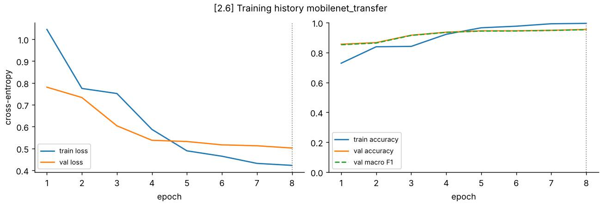{width=80%}

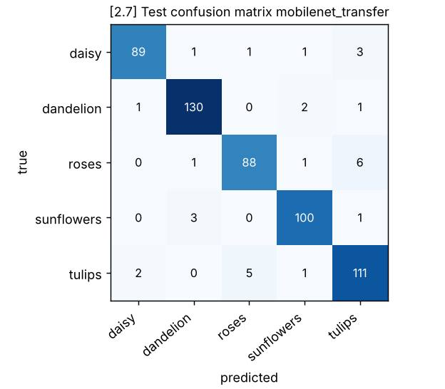{width=45%} 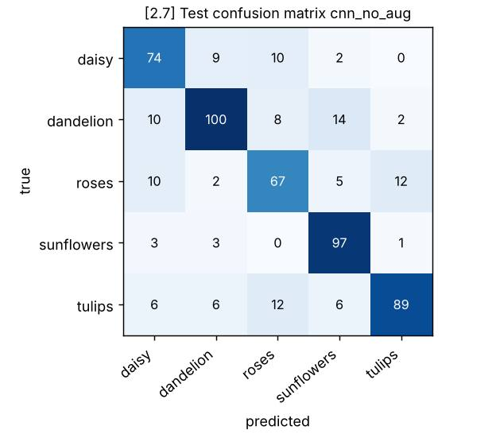{width=45%}

Figure 5.6: Test confusion matrices of MobileNetV3 (left) and the compact CNN (right); correct predictions lie on the diagonal.

**Discussion.**

- Pre-trained features are the decisive factor. Starting from ImageNet weights raises macro F1 from 0.78 to 0.95;
  about 2,500 images are too few to learn general visual features from scratch.
- Augmentation did not improve the compact CNN within 15 epochs (0.766 against 0.776). Its validation curve was still
  rising at the end of training: augmentation makes the task harder and needs more epochs than the budget allowed.
  It is retained for MobileNetV3, which converges quickly.
- The main confusion is between roses and tulips (11 of the 30 errors). Both are cup-shaped, often red or pink, and
  frequently photographed at close range. The remaining errors mostly involve yellow centres or petals (daisy,
  sunflower, dandelion).

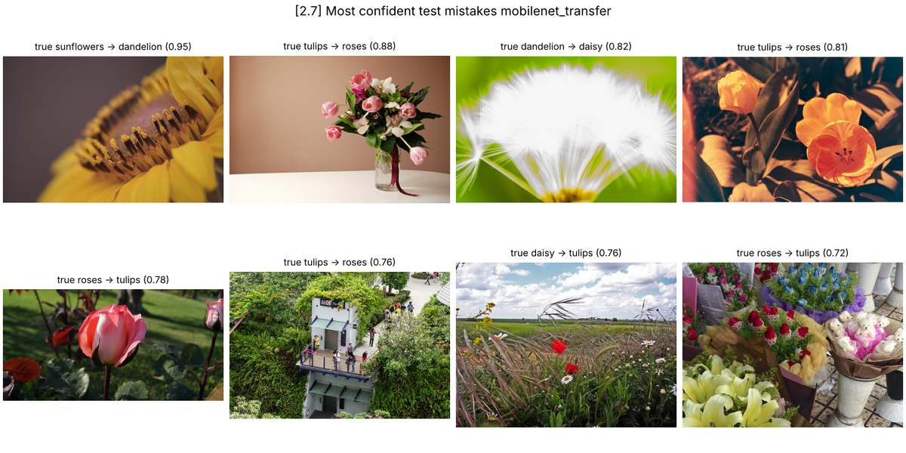{width=82%}

## 5.7 Comparison with non-deep baselines

To establish whether deep learning is necessary, simpler classifiers were trained on exactly the same split (Table
5.5).

| Method | Input representation | Test macro F1 |
| --- | --- | --- |
| Majority-class predictor | none | 0.08 |
| Best classical classifier (random forest) | hand-crafted colour, shape and texture descriptors | 0.70 |
| Linear classifier on frozen ImageNet features | MobileNetV3 features without adaptation | 0.92 |
| **Fine-tuned MobileNetV3 (selected)** | features adapted to flowers | **0.945** |

: Table 5.5: Comparison with non-deep and partially deep baselines.

An ablation of the hand-crafted descriptors shows that the classical classifier depends mainly on colour: removing
the colour features costs 0.39 in macro F1, texture 0.15 and shape 0.05. This dependence explains its confusion
between flowers of similar colour. Learned features are substantially better, and adapting them to the flower
domain adds about two further points.

## 5.8 Interpretability and confidence

A high test score does not show that the model relies on the right evidence. A model that attends to the background
may perform well on this dataset and fail in the field, so the following checks address reliability.

**Grad-CAM.** Let $A^k$ be the $k$-th feature map of the last convolutional layer and $y^c$ the score of the
predicted class. The importance of each map is the spatially averaged gradient, and the heat map is the positive part
of the weighted sum:

$$\alpha_k^c = \frac{1}{Z}\sum_{x, y}\frac{\partial y^c}{\partial A^k_{x,y}}, \qquad L^c_{\text{Grad-CAM}} = \operatorname{ReLU}\left(\sum_k \alpha_k^c A^k\right)$$ {#5.8}

where $Z$ is the number of spatial positions. The ReLU retains only evidence in favour of class $c$; the map is
up-sampled to the image size and overlaid. For MobileNetV3 the heat maps concentrate on the flowers, whereas the
compact CNNs often attend to sky or grass, which explains several of their errors (Figure 5.8).

**Deletion test.** If a heat map is faithful, removing its most salient pixels first should reduce the class
confidence faster than removing random pixels, giving a smaller area under the deletion curve. For MobileNetV3 the
area is 0.275 against 0.331 for random deletion, so its explanations are informative; for the baseline CNN the
explanations are no better than random (0.230 against 0.217).

**Confidence calibration.** The expected calibration error groups the $n$ predictions into $B$ confidence bins and
averages the gap between accuracy and confidence:

$$\text{ECE} = \sum_{b=1}^{B}\frac{|S_b|}{n}\,\left|\operatorname{acc}(S_b) - \operatorname{conf}(S_b)\right|$$ {#5.9}

A value of zero means that predictions made with 80 % confidence are correct 80 % of the time. All models are slightly
under-confident (ECE about 0.09), a known effect of label smoothing. The assistant therefore presents the confidence
as a score and not as an exact probability.

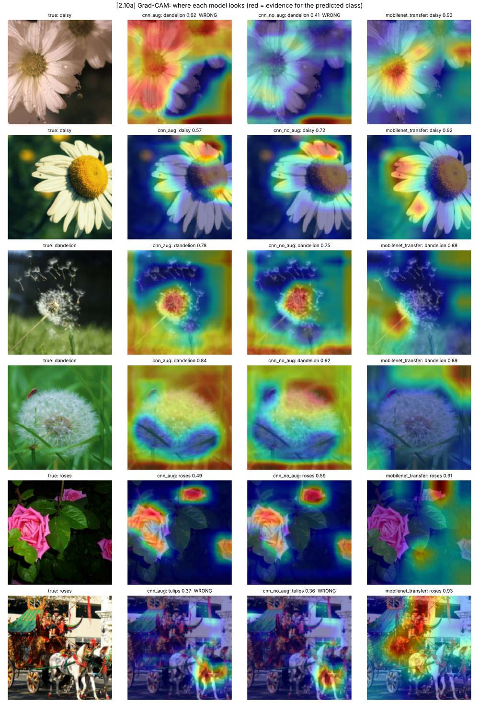{width=60%}

The trained model has been evaluated with accuracy, macro F1 and confusion matrices, and saved for use by the
assistant. This satisfies requirement (c).

# 6. The inspection assistant (Task 3)

## 6.1 Requirements

Tasks 1 and 2 produce separate engines; the assistant integrates them into one product, so that the user needs to
state only what they want to know and not which algorithm to run. The brief assesses two capabilities: correct
identification of the requested task (criterion 3.1) and execution of the corresponding module with a visual result
(criterion 3.2).

## 6.2 Task identification

The user expresses the intent by selecting one of six tasks and uploading an image, or two images for matching. The
assistant then follows the decision procedure of Figure 6.1. It reads the selected task and the inputs, and checks
that the task is known and that every required input is present; otherwise it returns an explanatory message. A
valid request is looked up in a single task table that associates each task name with exactly one engine function.
Because all capabilities are registered in one place, adding a task requires one new table entry.

<mark>[If the final version also interprets typed requests (for example "show me the edges" or "what flower is this?"), describe the keyword-matching rule here.]</mark>

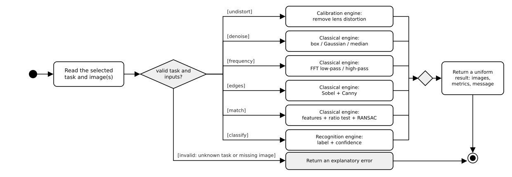{width=100%}

Three routing strategies were considered. A chain of conditional statements spreads the routing logic across the code
and becomes harder to verify with each new task. A large language model could interpret free text, but it may
misinterpret intent, can give different answers to the same request, and depends on an external service, all of which
are undesirable for an inspection tool. A task table keeps the routing in one visible structure, behaves
deterministically, can be tested task by task, and reports a precise error for any unknown request.

## 6.3 Execution and response

Every task returns the same structure: one or more captioned images, a small table of metrics, and a short message.
Because the structure is uniform, the interface can display any task without special cases. Table 6.1 lists the
engine and outputs of each task.

<mark>[Check this table against the final assistant and correct any row that differs.]</mark>

| Task | Engine | Images returned | Metrics returned |
| --- | --- | --- | --- |
| Undistort image | Calibration (saved camera parameters) | before / after | focal lengths, principal point, distortion, RMS error |
| Denoise | Classical: box, Gaussian and median filters | noisy input and three results | PSNR per filter |
| Frequency analysis | Classical: FFT filtering | spectrum, mask, low-pass and high-pass results | cut-off radius |
| Edge detection | Classical: Sobel and Canny | gradient magnitude, edge map | thresholds, fraction of edge pixels |
| Match two images | Classical: features, ratio test, RANSAC | both images with match lines | keypoints, matches, inliers |
| Identify flower | Trained classifier | input image (optionally with Grad-CAM) | class, confidence, top three |

: Table 6.1: Engine, images and metrics returned for each task.

Two implementation details make the integration reliable. The classifier is loaded once and kept in memory, so
subsequent requests are fast. Each image is pre-processed exactly as during training (same size and normalisation);
any mismatch would degrade accuracy.

## 6.4 User interface

The interface is a web page built with Streamlit. It offers a task selector, an upload field (and a second field for
matching), and displays the returned images, the metrics table and the message; errors appear in a highlighted box
with the explanation. Streamlit builds an interactive page from plain Python with ready-made upload, selection, image
and table components, and it runs locally on the machine that holds the model. Gradio would serve equally well,
whereas a full web framework such as Flask or Django would require considerably more work with no benefit for a
minimum viable product. Because the page contains no image-processing code, the notebook calls the same assistant,
and the figures in this report and the application are produced by the same functions.

<mark>[Insert one screenshot per task from the running application (undistort, denoise, frequency analysis, edges, matching, flower identification), saved as compressed JPEG to keep the PDF under 5 MB.]</mark>

<mark>[Add two or three example results from your own runs, for example "identify flower on a rose image: rose, score 0.93".]</mark>

# 7. Software engineering and reproducibility

The project was organised so that an examiner, or a new team member, can trace and repeat every result.

- **Layered structure.** Algorithms, task scripts that run each pipeline in order, and user-facing components (the
  notebook and the web application) are kept separate. The web application contains no image-processing code.
- **Traceable steps.** Each processing step is a separate, documented function labelled with a step identifier (for
  example 1A.3 for calibration). The same identifiers appear in the diagrams, the notebook and the code.
- **Central configuration.** Every path, size, threshold and hyperparameter is defined in one configuration file.
- **Baseline and improvement side by side.** Each method has a standard implementation and an improved or
  first-principles variant behind the same interface, which allows the quantitative comparisons reported above
  (calibration with and without $k_3$, library and hand-written filters, compact CNN and MobileNetV3).
- **Determinism.** A fixed random seed is used throughout, and every run writes its figures, tables and metrics to
  a results directory; every number in this report is taken from those files.
- **Automated tests.** Unit tests check that each core function returns outputs of the expected shape and type.
- **Portability.** The same code runs on a laptop CPU or on a free Google Colab GPU, selected by one configuration
  setting.

# 8. Code and dataset

## 8.1 Source code

The complete source code, configuration, unit tests, notebook and trained-model metadata are available in the
project repository:

<a href="https://github.com/NhatNam041206/UOG_FCVG101_ComputerVision">https://github.com/NhatNam041206/UOG_FCVG101_ComputerVision</a>

The repository is organised as follows (Table 8.1). Installation and run instructions for every task are given in
the repository's README file. The repository is maintained and pushed by the author. Commit messages follow the
Conventional Commits format, with a type prefix such as `feat` for a new feature, `fix` for a bug fix or `docs` for
documentation, so that the history of each change can be traced.

| Location | Contents |
| --- | --- |
| `src/` | Implementation of all engines: calibration, filtering, frequency analysis, edges, features, data pipeline, models, training, evaluation, baselines, explanations, inference and the assistant |
| `app.py` | Streamlit user interface |
| `configs/config.yaml` | All paths and parameters |
| `notebooks/` | Notebook that runs each task and reproduces the figures of this report |
| `tests/` | Unit tests for each task |
| `tools/task1a/` | Guided capture and undistortion tools used for the calibration images |
| `results/` | Figures, tables and metrics written by each run |
| `artifacts/` | Camera parameters, trained model weights and class lists |

: Table 8.1: Organisation of the code repository.

## 8.2 Datasets

| Dataset | Use | Size | Source and licence |
| --- | --- | --- | --- |
| Calibration images | Task 1A | 13 webcam images, $640 \times 480$ px | Captured for this project; included in the repository under `data/calibration/` |
| OpenCV test images | Task 1B | Harbour scene, two Pont du Gard views, cathedral interior | opencv_extra test-data collection [10] |
| TensorFlow Flowers | Task 2 | 3,670 images, 5 classes (3,649 after cleaning) | TensorFlow Datasets, CC-BY 2.0 [9]; downloaded automatically on first run |

: Table 8.2: Datasets used in the project.

The train, validation and test splits are written to the repository by the data pipeline, so the exact partition used
in Chapter 5 can be reproduced.

## 8.3 Trained model and reproduction

The selected MobileNetV3 weights (16.2 MB) and the ordered class list are distributed through
<mark>[shared link to the model weights and class list]</mark>; placing them in the `artifacts/` directory allows the
assistant to run without retraining. Retraining all models takes about 55 minutes on a four-core laptop CPU, or 10 to
15 minutes on a Colab GPU, where the notebook unpacks the project, runs every task and saves the results.

# 9. Limitations and future work

- **Calibration** used a single low-resolution webcam and a board displayed on a phone screen. Additional views with
  the board near the image corners would constrain the higher-order distortion coefficients more tightly.
- **Classical analysis** was evaluated on public sample images. Repeating it on undistorted images from the
  calibrated camera would connect Tasks 1A and 1B directly.
- **Flower recognition** covers five species photographed by amateurs. Deployment on a farm would require field
  images, further classes (for example diseases or ripeness stages) and a rejection option when confidence is low.
- **Depth and motion** (learning outcome 4) are outside the scope of this version. The matching and geometric
  verification of Section 4.5 are the natural starting point for stereo depth estimation or three-dimensional
  reconstruction.

# References

1. Z. Zhang, "A flexible new technique for camera calibration," *IEEE Transactions on Pattern Analysis and Machine Intelligence*, 22(11), 2000.
2. C. Harris and M. Stephens, "A combined corner and edge detector," *Proceedings of the Alvey Vision Conference*, 1988.
3. D. G. Lowe, "Distinctive image features from scale-invariant keypoints," *International Journal of Computer Vision*, 60(2), 2004.
4. E. Rublee, V. Rabaud, K. Konolige and G. Bradski, "ORB: an efficient alternative to SIFT or SURF," *ICCV*, 2011.
5. J. Canny, "A computational approach to edge detection," *IEEE Transactions on Pattern Analysis and Machine Intelligence*, 8(6), 1986.
6. M. A. Fischler and R. C. Bolles, "Random sample consensus," *Communications of the ACM*, 24(6), 1981.
7. A. Howard et al., "Searching for MobileNetV3," *ICCV*, 2019.
8. R. R. Selvaraju et al., "Grad-CAM: visual explanations from deep networks via gradient-based localization," *ICCV*, 2017.
9. The TensorFlow Team, "Flowers" dataset (tf_flowers), CC-BY 2.0, https://www.tensorflow.org/datasets/catalog/tf_flowers.
10. OpenCV contributors, opencv_extra test data, https://github.com/opencv/opencv_extra.
11. G. Bradski, "The OpenCV Library," *Dr. Dobb's Journal of Software Tools*, 2000.
12. PyTorch, https://pytorch.org; timm, https://github.com/huggingface/pytorch-image-models; Streamlit, https://streamlit.io.
